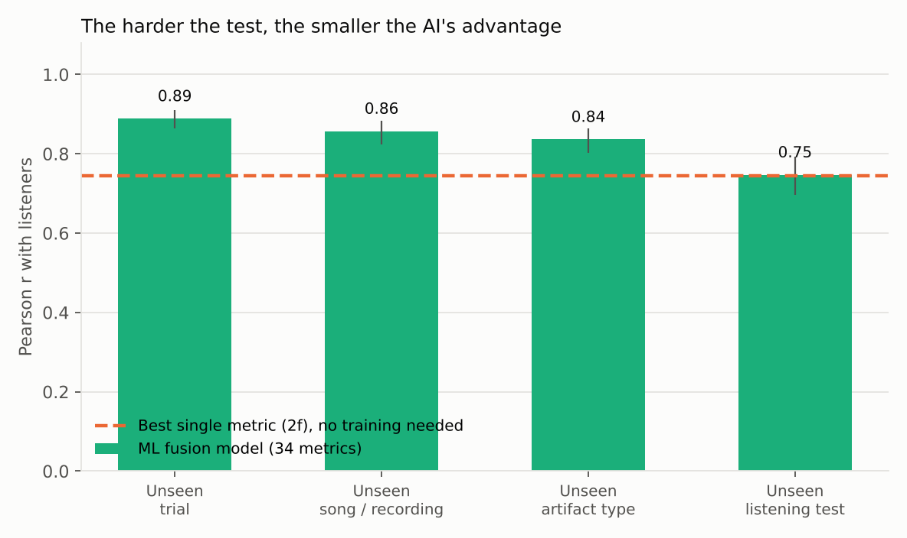

# Does the AI Hear What Listeners Hear?

**Testing 34 audio-quality metrics, 17 of them AI-based, against expert MUSHRA listening tests, and finding where they break.**

Objective metrics are only useful if they agree with listeners. This project checks that agreement on the open
[ODAQ dataset](https://github.com/Fraunhofer-IIS/ODAQ) (Fraunhofer IIS, Netflix, Ball State University): 488 processed audio clips from
96 MUSHRA trials across 16 artifact types, including codec artifacts, dialogue enhancement, stereo-image distortions and neural codecs.

It then trains a machine-learning "fusion" model that combines all 34 metrics, and tests it on audio it has never seen,
from an unseen trial up to a whole unseen listening test.

## Key findings

| | Result |
|---|---|
| Best single metric | **2f** (psychoacoustic model), r = 0.74 with listeners |
| Best AI metric | **SCOREQ (reference)**, r = 0.74, essentially tied with 2f |
| ML fusion model, unseen trials | **r = 0.89** (95% CI 0.86–0.91), typical error 9 MUSHRA points, reliably better than any single metric |
| ML fusion model, unseen listening test | **r = 0.75**, no better than 2f. **This is the limit.** |
| Hardest artifacts | **Stereo balance (ILD) and stereo width (ICC)**. Spatial distortions are hardest to predict |



**What it means for a product team:**
1. Use the fusion model to pre-screen versions of codecs and effects it was trained on, and send only close calls to a listening test.
2. Don't trust any metric on a new kind of processing until a small listening test confirms it.
3. Spatial quality (width, balance, imaging) needs dedicated metric work.

Full results with all figures and tables: **[results/RESULTS.md](results/RESULTS.md)**

## Method

- **Agreement** is the Pearson correlation between a metric and the listeners' mean MUSHRA score, computed **within each listening test and then averaged**. Different tests use the 0–100 scale slightly differently, so pooling them would be unfair.
- **Confidence intervals** (95%) come from a cluster bootstrap that resamples whole MUSHRA trials within each test, because clips in one trial share a reference and listeners and are not independent.
- **Fusion model:** gradient-boosted trees (ridge regression as a baseline) that predict the MUSHRA score from all 34 metric scores.
- **Generalization ladder:** leave-one-group-out testing at four levels: unseen trial, unseen song/recording, unseen artifact type, unseen listening test.
- **Where it breaks:** correlation by artifact type and content type, plus the 10 clips with the biggest prediction errors (`results/biggest_misses.csv`).
- Hidden references and low-pass anchors are excluded (they are fixed calibration points, not test conditions).

## Data source and credit

- Listening-test means and metric scores come from the **ODAQ benchmark** published by Fraunhofer IIS
  ([repository](https://github.com/Fraunhofer-IIS/ODAQ), [benchmark page](https://fraunhofer-iis.github.io/ODAQ/)).
  The 34 metric scores were computed by the ODAQ team. This project adds the within-test statistics, bootstrap confidence intervals, the ML fusion model, the generalization tests and the failure analysis.
- ODAQ paper: Torcoli et al., *ODAQ: Open Dataset of Audio Quality*, ICASSP 2024 ([arXiv:2401.00197](https://arxiv.org/abs/2401.00197)).
- No audio is redistributed here. `src/fetch_data.py` downloads only the published score files. ODAQ content is under Creative Commons licenses; see the ODAQ repository for terms.

## Run it

```bash
pip install -r requirements.txt
python src/fetch_data.py      # downloads ODAQ benchmark score files (~6 MB)
python src/build_dataset.py   # one row per clip: listener mean + 34 metric scores
python src/analyze.py         # stats, fusion model, figures, results/RESULTS.md (~3 min)
```

## Repository

```
src/fetch_data.py       download ODAQ benchmark scores
src/build_dataset.py    build the per-clip table
src/analyze.py          analysis, ML model, figures, auto-generated report
results/                CSVs, summary.json, RESULTS.md
figures/                four charts
```

## Next steps

- Train the fusion model on the audio directly (e.g., embeddings from a pretrained audio model) instead of on other metrics' scores.
- Add a spatial-specific feature set (interaural cues) to target the weakest artifact types.
- Calibrate per listening test with a few anchor clips to close the "unseen test" gap.

---
Built by **Oveal Walker**, perceptual audio engineer (12+ years of MUSHRA/BS.1116 listening-test design at SRS Labs and Xperi/DTS). Developed with AI-assisted coding (Claude).
