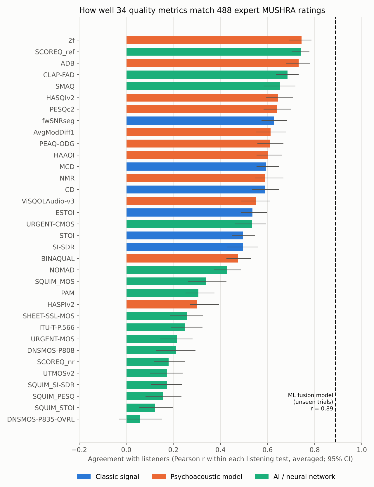
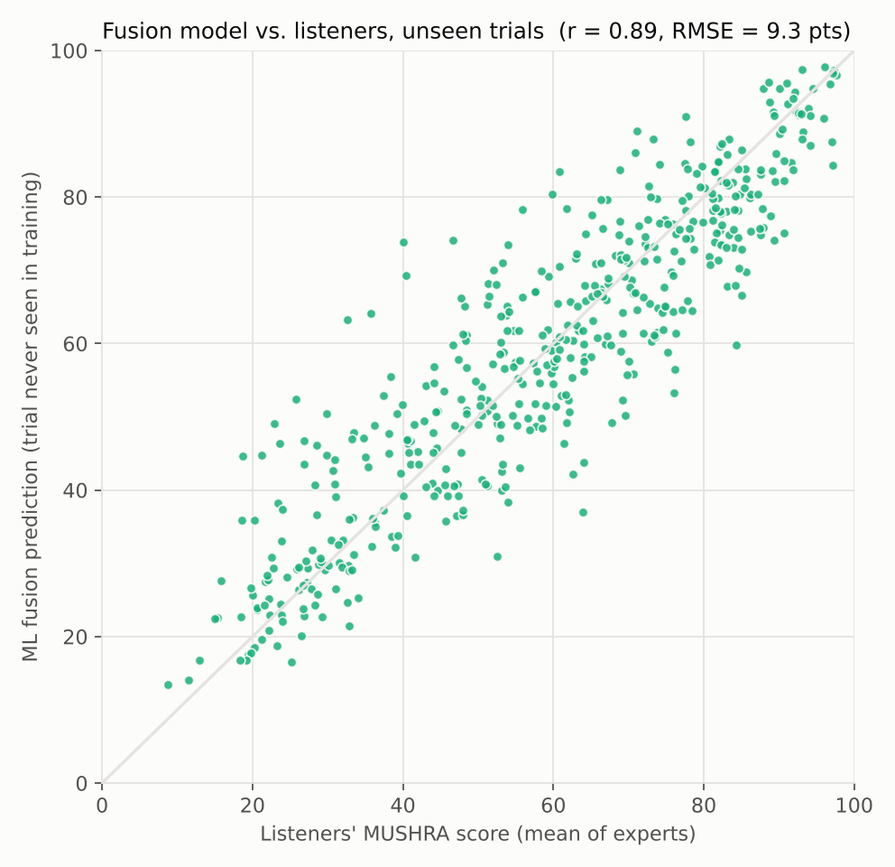
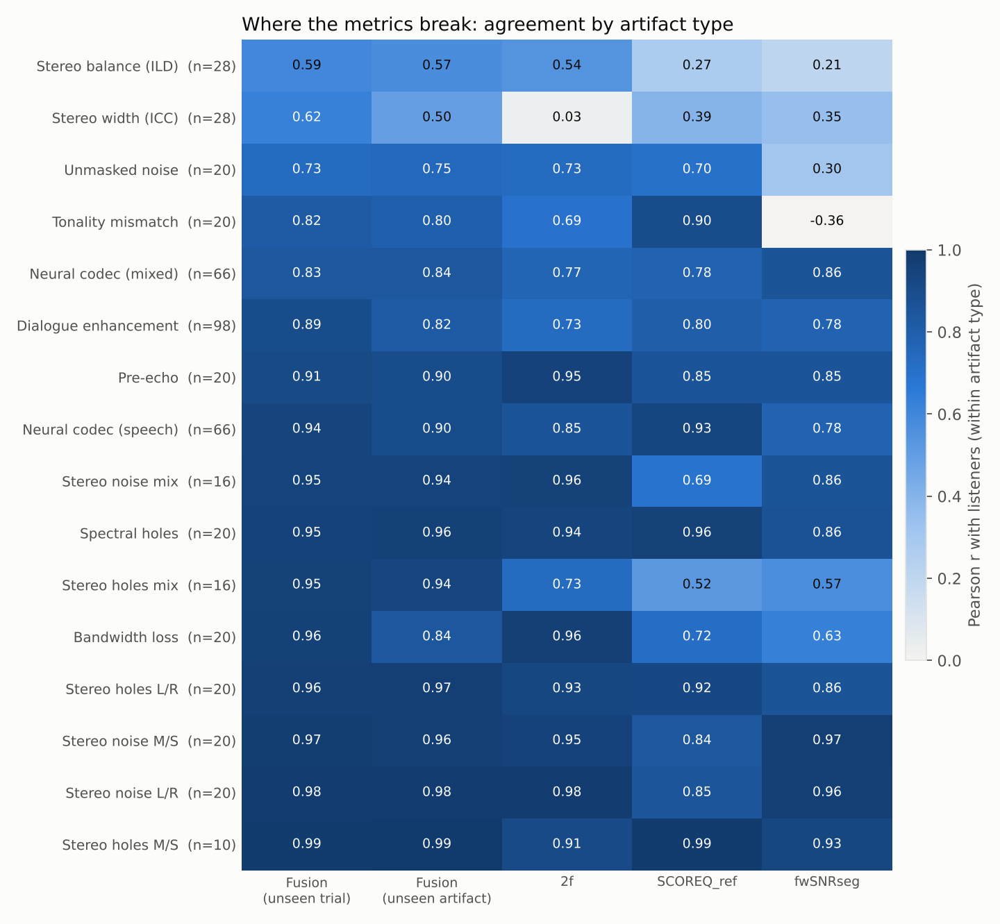
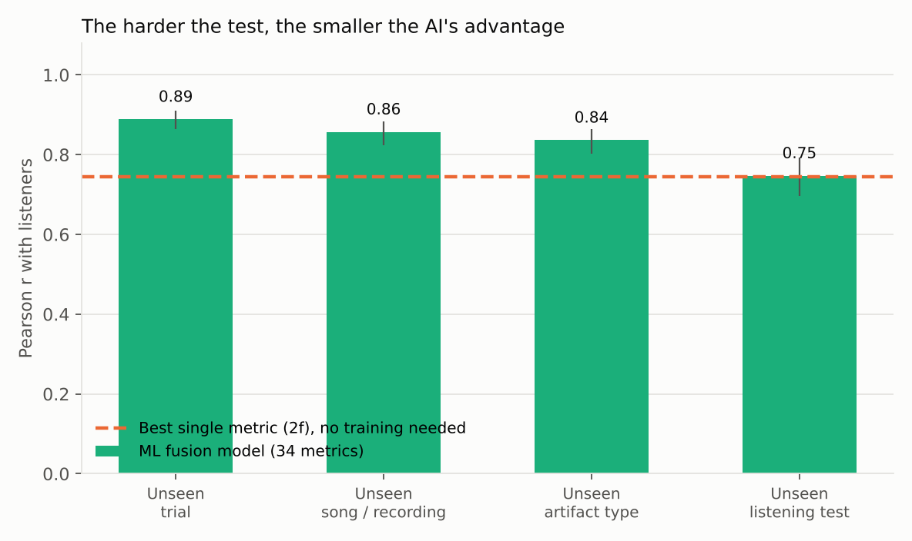

# Results: Does the AI hear what listeners hear?

*Auto-generated by `src/analyze.py`. Every number comes from the files in `results/`.*

## Headline

- **Data:** 488 processed audio clips from 96 MUSHRA trials and 16 artifact types, rated by expert listeners in four ODAQ listening tests (hidden references and anchors excluded).
- **Scoring:** agreement = Pearson r between a metric and the listeners' mean score, computed inside each listening test and then averaged. 95% confidence intervals come from resampling whole MUSHRA trials.
- **Best single metric:** 2f (psychoacoustic model), r = 0.74 (95% CI 0.69–0.79).
- **Best by family:** psychoacoustic 2f 0.74 · AI SCOREQ_ref 0.74 · classic fwSNRseg 0.63. The best AI model essentially tied the best engineered psychoacoustic model; no off-the-shelf model clearly wins.
- **ML fusion model** (gradient-boosted trees combining all metrics), on trials it never saw: r = 0.89 (95% CI 0.86–0.91), typical error 9.3 MUSHRA points. Versus 2f: reliably better (difference 95% CI +0.11 to +0.19).
- **The limit:** on a listening test it never saw, the fusion model scores r = 0.75: no reliable difference than 2f (difference 95% CI -0.03 to +0.04). It learns the conditions it was trained on; it does not yet transfer to new ones.
- **Weakest artifact types:** Stereo balance (ILD) (r = 0.59); Stereo width (ICC) (r = 0.62); Unmasked noise (r = 0.73). Stereo-image (width/balance) distortions were the hardest to predict.

## Generalization ladder

| Test | Fusion r | 95% CI | Typical error (pts) | Best single metric r | Fusion vs. single |
|---|---|---|---|---|---|
| Unseen trial | 0.89 | 0.86–0.91 | 9.3 | 0.74 | reliably better |
| Unseen song / recording | 0.86 | 0.82–0.88 | 10.4 | 0.74 | reliably better |
| Unseen artifact type | 0.84 | 0.80–0.86 | 12.3 | 0.74 | reliably better |
| Unseen listening test | 0.75 | 0.70–0.79 | 16.5 | 0.74 | no reliable difference |

## What this means for a product team

1. **Pre-screen with the model** when testing versions of a codec or effect it has been trained on, and send only close calls to a listening test.
2. **Do not trust it on a new kind of processing** (a new codec tool, a new spatial effect) until a small listening test confirms it. Out of the box it is no better than the best psychoacoustic model.
3. **Spatial quality needs its own metric work.** Stereo width and balance changes were the hardest to predict, for the fusion model and for the single metrics shown.
4. **Low agreement inside one artifact type** can also mean a narrow quality range or listener disagreement; check listener spread before blaming the metric.

## Figures

## Top 10 single metrics

| Metric | Family | Pearson r (within test) | 95% CI | Spearman |
|---|---|---|---|---|
| 2f | Psychoacoustic model | 0.74 | 0.69 – 0.79 | 0.72 |
| SCOREQ_ref | AI / neural network | 0.74 | 0.70 – 0.78 | 0.74 |
| ADB | Psychoacoustic model | 0.73 | 0.68 – 0.78 | 0.72 |
| CLAP-FAD | AI / neural network | 0.68 | 0.63 – 0.73 | 0.68 |
| SMAQ | AI / neural network | 0.65 | 0.58 – 0.72 | 0.66 |
| HASQIv2 | Psychoacoustic model | 0.64 | 0.59 – 0.71 | 0.64 |
| PESQc2 | Psychoacoustic model | 0.64 | 0.58 – 0.70 | 0.67 |
| fwSNRseg | Classic signal | 0.63 | 0.57 – 0.68 | 0.60 |
| AvgModDiff1 | Psychoacoustic model | 0.61 | 0.55 – 0.68 | 0.64 |
| PEAQ-ODG | Psychoacoustic model | 0.61 | 0.56 – 0.67 | 0.60 |
